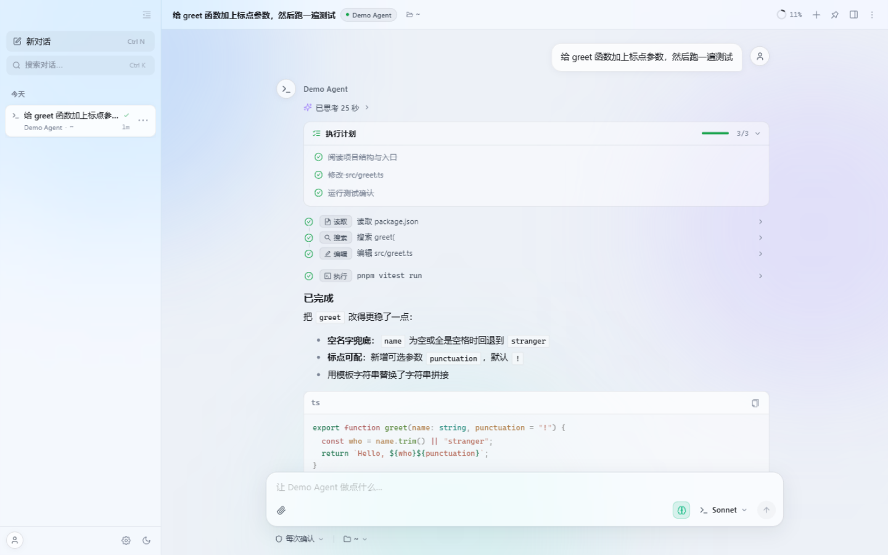
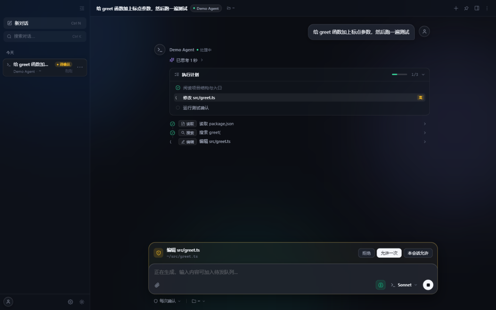
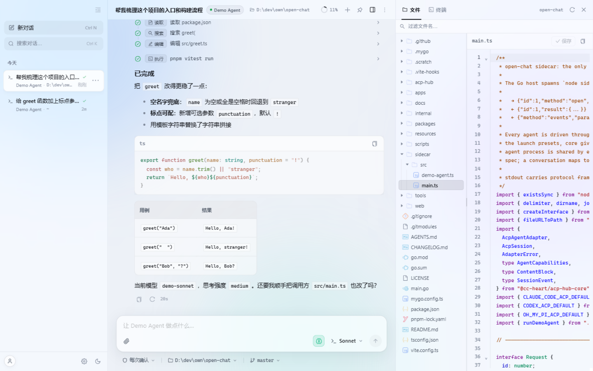

<div align="center">
  
  <h1>Antdv Next X-Chat</h1>
  <p>One workspace for the coding agents on your machine.</p>
  <p>English · <a href="./README.zh-CN.md">简体中文</a></p>
  <p>
    <a href="https://github.com/antdv-next/x-chat"></a>
    <a href="LICENSE"></a>
  </p>
</div>

X-Chat is a local-first desktop and web workbench for Claude Code, Codex, Pi, Oh My Pi, and custom coding agents. It connects to the agents you already have installed through the [Agent Client Protocol (ACP)](https://agentclientprotocol.com).

<p align="center">
  
</p>

## ✨ Features

- **Multiple agents in one workspace.** Each conversation has a working directory. Use slash commands, choose models and thinking levels, and attach images where the agent supports them.
- **Permission controls next to the composer.** Respond to tool requests as they arrive, or switch between asking each time, auto-approval, and full access. Permission modes sync to the agent over ACP.
- **Live, resumable conversations.** Plans, thinking, tool calls, diffs, and terminal output stream into the transcript. Conversations are saved locally and resume through `session/load` when the agent supports it.
- **Editor and terminal side by side.** Browse the file tree with Catppuccin icons, edit files in CodeMirror 6, and run a terminal next to the conversation. Save with `⌘S` or `Ctrl+S`.
- **Desktop and browser from one binary.** The frontend and sidecar ship with the app. X-Chat reads the login shell environment to find tools even when opened from the Dock. Use `x-chat serve` to open the same UI from a browser on your LAN.

<p align="center">
  
  
</p>

## 📦 Quick start

Clone the repository and run `pnpm install`. Start the desktop app with `pnpm dev` or open the browser UI with `pnpm serve`.

To use the same UI in a browser, open the URL printed by `x-chat serve`:

```bash
x-chat serve                                          # localhost:4310, random token
x-chat serve -addr 0.0.0.0:4310 -token '<your-token>'  # listen on the LAN
x-chat serve -no-auth                                 # local development
```

## Architecture

The Go host runs the desktop window, manages sessions and storage, and starts the Node.js sidecar. The sidecar bundles [acp-hub](https://github.com/CarlOpenLab/acp-hub) into a single `.mjs` file embedded in the binary. At runtime the host extracts it to the cache directory and exchanges NDJSON with it over stdio. The sidecar handles ACP handshakes, session events, and permission requests, and shares one child process per agent across conversations.

```text
Vue UI  ⇄  Go host (mygo)  ⇄  Node.js sidecar (acp-hub)  ⇄  coding agents
          Host API + push     NDJSON over stdio           ACP over stdio
```

In the desktop app the UI calls `Host.*`. In `serve` mode it calls `POST /api/call/<Method>` and receives `push` events over `GET /api/push` via SSE. `web/src/api.ts` selects the transport, and `web/src/transcript.ts` uses the same reducer for saved and live events.

## Configuration and data

The default data directory is `~/.config/x-chat` on Linux, `~/Library/Application Support/x-chat` on macOS, and `%AppData%\x-chat` on Windows. Set `X_CHAT_DATA` to use another directory. In `serve` mode, `X_CHAT_TOKEN` sets the access token unless `-token` or `-no-auth` overrides it.

- `settings.json` stores theme, send key, permission defaults, recent folders, default agent, the Node.js path, and built-in or custom agent commands, arguments, and environment variables. Edit these in Settings.
- `index.json` and `conversations/<id>.json` store local conversations. Writes are atomic and compact streaming deltas, tool updates, plans, and permission results before saving.

## 🛠 Development

Use Node.js 22.6 or later, the pnpm version in `package.json`, and the Go version in `go.mod`.

```bash
git clone https://github.com/antdv-next/x-chat.git
cd x-chat
pnpm install
pnpm build:sidecar                 # bundle into internal/sidecar/dist
pnpm dev                           # desktop window + Vite on port 5173
```

For browser-only development, run `pnpm dev:web` and start `go run . serve -no-auth` in another terminal. Vite proxies `/api` to `127.0.0.1:4310`.

```bash
pnpm typecheck
go test ./...                      # includes Node.js sidecar catalog integration
pnpm build:web && go build ./...   # build the embedded UI and compile Go packages
pnpm build                        # package installers under build/<os>-<arch>/
```

| Path | Purpose |
| --- | --- |
| `main.go` | Entry point for `x-chat` and `x-chat serve` |
| `internal/host/` | Sessions, persistence, sidecar lifecycle, Host API, and HTTP service |
| `sidecar/src/main.ts` | ACP integration through acp-hub |
| `web/src/` | Vue frontend built with Antdv Next and Antdv X |
| `internal/webdist/` | Embedded frontend build |

## Contributing

Bug reports, feature suggestions, documentation improvements, and pull requests are welcome. When reporting a bug, include your OS, X-Chat version, agent, and steps to reproduce it. [GitHub Issues](https://github.com/antdv-next/x-chat/issues)

For a pull request, fork the repository, create a branch from `main`, and run `pnpm typecheck` and `go test ./...` after building the sidecar. Keep the ACP implementation in `sidecar/` and send UI requests through the Host API. [Development guidelines](AGENTS.md)

## Acknowledgements

- The Vue components behind the interface. [Antdv Next](https://github.com/antdv-next/antdv-next) · [Antdv X](https://github.com/antdv-next/x)
- The desktop runtime and packaging tools. [mygo](https://github.com/egoist/mygo)
- The protocol and adapters behind agent sessions. [ACP](https://agentclientprotocol.com) · [acp-hub](https://github.com/CarlOpenLab/acp-hub)

## License

[MIT](LICENSE) © 2026 Antdv Next Team
