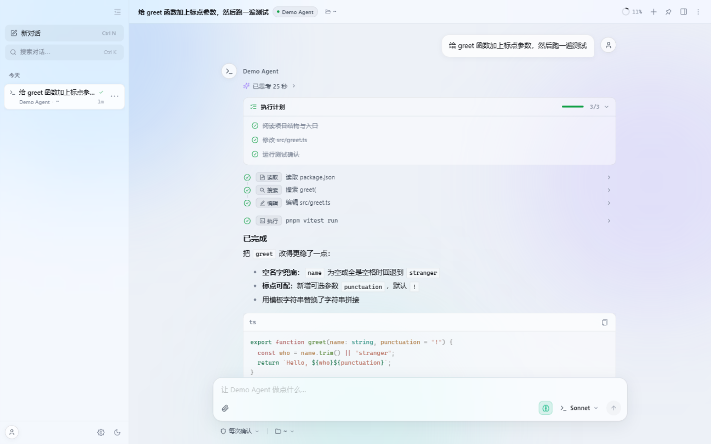
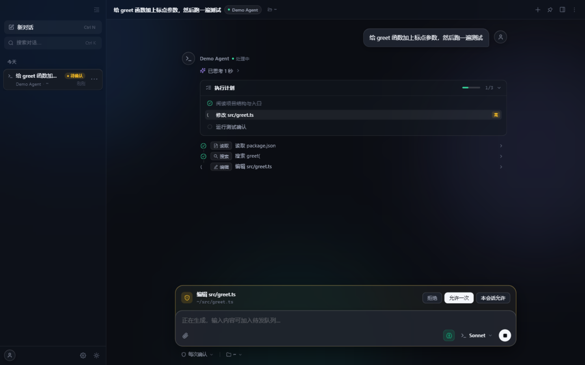
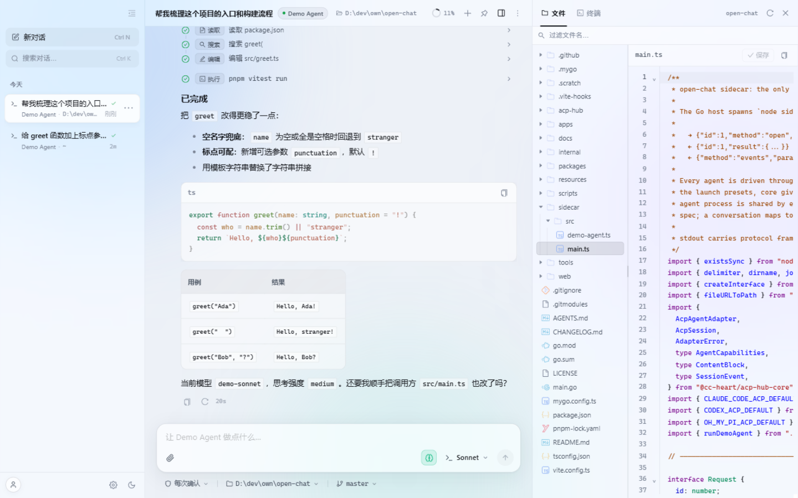

<div align="center">
  
  <h1>Antdv Next X-Chat</h1>
  <p>在同一个工作台使用本机的编程 Agent。</p>
  <p><a href="./README.md">English</a> · 简体中文</p>
  <p>
    <a href="https://github.com/antdv-next/x-chat"></a>
    <a href="LICENSE"></a>
  </p>
</div>

X-Chat 是一个本地优先的桌面与 Web 工作台。它通过 [Agent Client Protocol（ACP）](https://agentclientprotocol.com) 连接本机已安装的 Claude Code、Codex、Pi、Oh My Pi，也支持自定义编程 Agent。

<p align="center">
  
</p>

## ✨ 功能特性

- **在一个工作台使用多个 Agent。** 每个会话绑定一个工作目录。可按 Agent 的能力使用斜杠命令、选择模型和思考级别、添加图片附件。
- **在输入框上方处理权限请求。** 可逐次确认、自动批准或授予完整访问权限。权限模式通过 ACP 实时同步给 Agent。
- **实时查看并恢复会话。** 思考过程、计划、工具调用、差异和终端输出会流式显示。对话保存在本地，支持恢复的 Agent 可通过 `session/load` 继续会话。
- **对话旁边就是编辑器和终端。** 文件树使用 Catppuccin 图标，编辑器使用 CodeMirror 6，按 `⌘S` 或 `Ctrl+S` 保存文件。
- **同一份程序支持桌面和浏览器。** 应用内置前端和 sidecar，从 Dock 启动时也会读取登录 Shell 环境以查找命令。运行 `x-chat serve` 即可在局域网的浏览器中打开同一套界面。

<p align="center">
  
  
</p>

## 📦 快速开始

克隆仓库后运行 `pnpm install`。使用 `pnpm dev` 启动桌面应用，或使用 `pnpm serve` 在浏览器中打开工作台。

在浏览器使用时，打开 `x-chat serve` 打印的网址。

```bash
x-chat serve                                          # 本机 4310 端口，随机令牌
x-chat serve -addr 0.0.0.0:4310 -token '<your-token>'  # 允许局域网访问
x-chat serve -no-auth                                 # 用于本地开发
```

## 架构

Go 宿主负责桌面窗口、会话、数据存储和 Node.js sidecar 的生命周期。sidecar 将 [acp-hub](https://github.com/CarlOpenLab/acp-hub) 打包为一个嵌入二进制的 `.mjs` 文件。运行时，宿主将该文件释放到缓存目录，通过标准输入输出交换 NDJSON。ACP 握手、会话事件和权限请求由 sidecar 处理，同一 Agent 的多个会话共享一个子进程。

```text
Vue 界面  ⇄  Go 宿主（mygo）  ⇄  Node.js sidecar（acp-hub）  ⇄  编程 Agent
           Host API + push      标准输入输出上的 NDJSON         标准输入输出上的 ACP
```

桌面界面调用 `Host.*`。在 `serve` 模式下，界面调用 `POST /api/call/<Method>`，并通过 `GET /api/push` 的 SSE 流接收 `push` 事件。`web/src/api.ts` 选择传输方式，`web/src/transcript.ts` 使用同一个 reducer 处理存档回放与实时事件。

## 配置与数据

默认数据目录在 Linux 上是 `~/.config/x-chat`，在 macOS 上是 `~/Library/Application Support/x-chat`，在 Windows 上是 `%AppData%\x-chat`。可用 `X_CHAT_DATA` 指定其他目录。在 `serve` 模式下可用 `X_CHAT_TOKEN` 设置访问令牌，`-token` 和 `-no-auth` 优先。

- `settings.json` 保存主题、发送快捷键、默认权限、最近使用的目录、默认 Agent、Node.js 路径，以及内置或自定义 Agent 的命令、参数和环境变量。可通过设置界面修改。
- `index.json` 和 `conversations/<id>.json` 保存本地会话。写入采用原子操作，落盘前会合并流式增量、工具更新、计划和权限结果。

## 🛠 开发

使用 Node.js 22.6 或更新版本。pnpm 和 Go 版本分别见 `package.json` 与 `go.mod`。

```bash
git clone https://github.com/antdv-next/x-chat.git
cd x-chat
pnpm install
pnpm build:sidecar                 # 打包到 internal/sidecar/dist
pnpm dev                           # 桌面窗口 + Vite（5173 端口）
```

只在浏览器中开发时，运行 `pnpm dev:web`，并在另一个终端启动 `go run . serve -no-auth`。Vite 会将 `/api` 代理至 `127.0.0.1:4310`。

```bash
pnpm typecheck
go test ./...                      # 包含 Node.js sidecar 的 Agent 目录集成测试
pnpm build:web && go build ./...   # 构建嵌入式前端并编译 Go 包
pnpm build                        # 安装包输出到 build/<os>-<arch>/
```

| 路径 | 用途 |
| --- | --- |
| `main.go` | `x-chat` 和 `x-chat serve` 的入口 |
| `internal/host/` | 会话、存储、sidecar 生命周期、Host API 和 HTTP 服务 |
| `sidecar/src/main.ts` | 通过 acp-hub 接入 ACP |
| `web/src/` | 使用 Antdv Next 和 Antdv X 的 Vue 前端 |
| `internal/webdist/` | 嵌入二进制的前端构建产物 |

## 参与贡献

欢迎提交问题、功能建议、文档改进和 Pull Request。反馈问题时，请附上系统、X-Chat 版本、使用的 Agent 和复现步骤。[GitHub Issues](https://github.com/antdv-next/x-chat/issues)

提交 PR 时，请 Fork 仓库并从 `main` 创建分支。构建 sidecar 后运行 `pnpm typecheck` 和 `go test ./...`。ACP 实现放在 `sidecar/`，界面通过 Host API 发出请求。[开发约定](AGENTS.md)

## 致谢

- 提供 Vue 界面组件的 [Antdv Next](https://github.com/antdv-next/antdv-next) 和 [Antdv X](https://github.com/antdv-next/x)。
- 提供桌面运行时和打包工具的 [mygo](https://github.com/egoist/mygo)。
- 为 Agent 会话提供协议和适配器的 [ACP](https://agentclientprotocol.com) 和 [acp-hub](https://github.com/CarlOpenLab/acp-hub)。

## 许可证

[MIT](LICENSE) © 2026 Antdv Next Team
